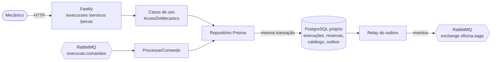

# Oficina Mecânica — Execução e Produção

Microsserviço da **fila do mecânico**: diagnóstico, reparo, catálogo de serviços e estoque de peças. Participa da saga de atendimento orquestrada pelo [OS Service](https://github.com/Xikin/tech_challenge). Tech Challenge — Fase 4.

| Repositório | Papel |
| --- | --- |
| [oficina-mvp](https://github.com/Xikin/tech_challenge) | OS Service — orquestrador da saga; diagrama geral e ADRs da Fase 4 |
| **oficina-execucao** (este) | Execução e Produção |
| [oficina-billing](https://github.com/Xikin/oficina-billing) | Orçamento e Pagamento |
| [oficina-auth-lambda](https://github.com/Xikin/oficina-auth-lambda) · [oficina-infra-k8s](https://github.com/Xikin/oficina-infra-k8s) · [oficina-infra-db](https://github.com/Xikin/oficina-infra-db) | Autenticação e infraestrutura |

## Responsabilidades

- **Fila de execução:** recebe a OS aberta e organiza o trabalho do mecânico. Primeiro aparece o que está em reparo, depois o que está em diagnóstico, aguardando reparo e na fila; dentro de cada grupo, a mais antiga primeiro.
- **Diagnóstico:** o mecânico informa os serviços e as peças necessários. As peças são **reservadas** no estoque na mesma transação, e os itens seguem para o orçamento.
- **Reparo:** só começa depois que o pagamento libera a OS. Ao iniciar, as peças reservadas são consumidas; ao finalizar, o tempo real é registrado por serviço.
- **Comunica a finalização ao OS Service** pelo evento `execucao.evento.execucao-finalizada`.
- **Catálogo e estoque:** serviços com preço e tempo previsto, peças com estoque mínimo e alertas. Herdados do monólito da Fase 3.

## Arquitetura



Clean Architecture em quatro camadas (`domain`, `application`, `infrastructure`, `presentation`), como no OS Service. A máquina de estados da execução é uma função pura em [`src/domain/execucao/execucao.ts`](src/domain/execucao/execucao.ts):

```
NA_FILA → EM_DIAGNOSTICO → DIAGNOSTICADA → AGUARDANDO_REPARO → EM_REPARO → FINALIZADA
                                       ↘ (falha)  FALHOU        ↘ (cancelamento) CANCELADA
```

## Na saga

| Recebe | Faz | Responde |
| --- | --- | --- |
| `execucao.comando.abrir-diagnostico` | Coloca a OS na fila | — (o evento vem quando o mecânico começa) |
| `execucao.comando.liberar-execucao` | Libera para reparo depois do pagamento | — |
| `execucao.comando.cancelar` | Cancela e devolve ao estoque as peças ainda reservadas | `execucao.evento.cancelada` |

| Ação do mecânico | Publica |
| --- | --- |
| `POST /execucoes/:id/diagnostico/iniciar` | `execucao.evento.diagnostico-iniciado` |
| `POST /execucoes/:id/diagnostico/concluir` | `execucao.evento.diagnostico-concluido` com os itens |
| `POST /execucoes/:id/reparo/iniciar` | `execucao.evento.execucao-iniciada` |
| `POST /execucoes/:id/reparo/finalizar` | `execucao.evento.execucao-finalizada` |
| `POST /execucoes/:id/falha` | `execucao.evento.execucao-falhou` → a saga estorna o cliente |

**Garantias:**

- Os eventos saem por outbox transacional, gravado na mesma transação da mudança de status e da reserva.
- Os comandos são deduplicados por id (`mensagens_processadas`).
- A baixa de estoque é condicional (`quantidade >= n`), então duas reservas simultâneas nunca deixam o saldo negativo.
- O cancelamento **sempre** confirma, mesmo se chegar antes da abertura (registra a OS como cancelada para ignorar a abertura atrasada) ou depois de a execução terminar. Assim a saga nunca fica esperando.

Contrato completo e cenários de falha: [docs/saga.md do OS Service](https://github.com/Xikin/tech_challenge/blob/main/docs/saga.md).

## Banco de dados

**PostgreSQL em instância RDS própria** (`oficina-infra-db`, parâmetro `/oficina/<env>/db/execucao_database_url`). O OS Service não tem essa credencial. Relacional porque o estoque precisa de baixa condicionada dentro da mesma transação que conclui o diagnóstico ([ADR-0016](https://github.com/Xikin/tech_challenge/blob/main/docs/adr/0016-persistencia-poliglota.md)).

Tabelas: `servicos`, `pecas`, `execucoes`, `itens_servico_execucao`, `reservas_peca`, `historico_execucao`, `outbox`, `mensagens_processadas`.

## API

- **Swagger:** `/docs` no serviço; pelo API Gateway as rotas são `/execucoes`, `/servicos` e `/pecas`
- **OpenAPI:** [`docs/openapi.json`](docs/openapi.json) · **Postman:** [`postman/`](postman/)
- Todas as rotas exigem o token interno (funcionário ou admin) emitido pelo OS Service.

## Executar

Pelo `docker-compose.yml` do OS Service, que sobe os três serviços (ver o [README de lá](https://github.com/Xikin/tech_challenge#executar-localmente)). Sozinho:

```bash
npm ci
cp .env.example .env
npx prisma migrate deploy
npm run db:seed
npm run dev
```

## Testes e qualidade

| Tipo | Comando | Resultado |
| --- | --- | --- |
| Unitários e de integração (Vitest) | `npm test` | 91 testes |
| Qualidade (SonarQube Cloud) | pipeline | quality gate bloqueia a imagem |

**Cobertura:**

| Camada | Linhas |
| --- | --- |
| domain | 96,0% |
| application | 100% |
| infrastructure | 99,0% |
| presentation | 100% |
| **total** | **98,4%** linhas · 92,0% branches · 99,2% funções |

O pipeline exige no mínimo 80% em linhas, branches, funções e statements. O relatório HTML fica no artefato `coverage` de cada execução.

## CI/CD e Kubernetes

`.github/workflows/ci-cd.yml`:

- **PR:** formatação, typecheck, migrations, build, testes com cobertura e Sonar com quality gate.
- **Push:** tudo isso, mais a imagem no ECR (`/oficina/<env>/ecr/execucao_repository_url`) e o deploy no EKS. O deploy aplica `k8s/` e roda o Job do catálogo inicial (`k8s/job-catalogo.yaml`, idempotente). Depois publica o endereço em `/oficina/<env>/execucao/endpoint` e faz o smoke test.

Depende de, no SSM: `eks/cluster_name`, `db/execucao_database_url`, `mensageria/rabbitmq_url` e `auth/jwt_secret`. Este último é publicado pelo primeiro deploy do OS Service. Secrets do repositório: credenciais do Learner Lab, `SONAR_TOKEN` e as chaves do New Relic.

Decisões de código e configuração, por arquivo: [docs/notas-de-implementacao.md](docs/notas-de-implementacao.md).
